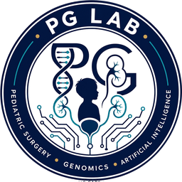
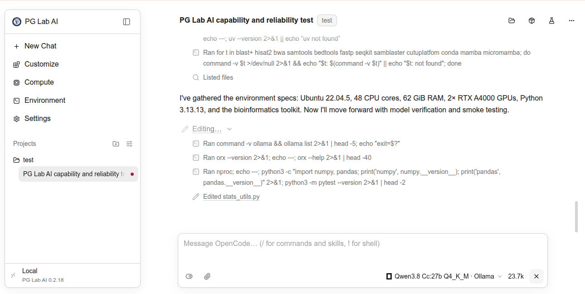

<div align="center">

<h1> PG Lab AI</h1>

面向科学发现的 AI 驱动工作空间。

<p>
<a href="https://github.com/imrobintomar/PG-Lab-AI/releases/latest"></a>
<a href="https://github.com/imrobintomar/PG-Lab-AI/blob/main/LICENSE"></a>
</p>

<p><a href="README.md">English</a> · <a href="README.es.md">Español</a> · <a href="README.ko.md">한국어</a> · <a href="README.zh.md">简体中文</a> · <a href="README.ja.md">日本語</a></p>

<p></p>

<hr />

<p>无论你需要的是助手还是自主研究工具，PG Lab AI 都将加速你的工作。 启动研究智能体，让它们查阅文献、提出假设、运行实验并生成研究成果。</p>

<p>
<a href="https://github.com/imrobintomar/PG-Lab-AI/releases/latest/download/PG-Lab-AI.dmg"><picture><source media="(prefers-color-scheme: dark)" srcset=".github/readme-assets/download-macos-dark.svg"></picture></a>
<a href="https://github.com/imrobintomar/PG-Lab-AI/releases/latest/download/PG-Lab-AI-Setup.exe"><picture><source media="(prefers-color-scheme: dark)" srcset=".github/readme-assets/download-windows-dark.svg"></picture></a>
<a href="https://github.com/imrobintomar/PG-Lab-AI/releases/latest/download/PG-Lab-AI-x86_64.AppImage"><picture><source media="(prefers-color-scheme: dark)" srcset=".github/readme-assets/download-linux-dark.svg"></picture></a>
</p>

<p>
<a href="https://github.com/imrobintomar/PG-Lab-AI/tree/main/docs"></a>
<a href="https://github.com/imrobintomar/PG-Lab-AI/releases"></a>
</p>

<p><sub>macOS 11+ · Windows 测试版需要 <a href="docs/windows.md">Git for Windows</a> · <a href="docs/linux.md">Linux</a> 应用需要 glibc 2.35+</sub></p>

</div>

## 开始使用

**推荐使用 PG Lab AI 桌面应用。** 下载适合你平台的版本：

| 平台 | 下载 |
| --- | --- |
| macOS 11+（Apple 芯片和 Intel） | [PG-Lab-AI.dmg](https://github.com/imrobintomar/PG-Lab-AI/releases/latest/download/PG-Lab-AI.dmg) |
| Windows 10/11（测试版） | [PG-Lab-AI-Setup.exe](https://github.com/imrobintomar/PG-Lab-AI/releases/latest/download/PG-Lab-AI-Setup.exe) |
| Linux x86_64 | [PG-Lab-AI-x86_64.AppImage](https://github.com/imrobintomar/PG-Lab-AI/releases/latest/download/PG-Lab-AI-x86_64.AppImage) |
| Linux ARM64 | [PG-Lab-AI-aarch64.AppImage](https://github.com/imrobintomar/PG-Lab-AI/releases/latest/download/PG-Lab-AI-aarch64.AppImage) |
| 命令行（macOS/Linux） | `curl -LsSf https://github.com/imrobintomar/PG-Lab-AI/releases/latest/download/pg-lab-ai-cli-installer.sh \| sh` |
| 命令行（Windows PowerShell） | `powershell -ExecutionPolicy Bypass -c "irm https://github.com/imrobintomar/PG-Lab-AI/releases/latest/download/pg-lab-ai-cli-installer.ps1 \| iex"` |

当前版本：**[v1.1.0](https://github.com/imrobintomar/PG-Lab-AI/releases/tag/v1.1.0)** · [所有版本](https://github.com/imrobintomar/PG-Lab-AI/releases) · 上面的链接始终下载最新版本。

<details>
<summary>更喜欢独立 CLI？在 macOS 或 Linux 上安装</summary>

```sh
curl -LsSf https://github.com/imrobintomar/PG-Lab-AI/releases/latest/download/pg-lab-ai-cli-installer.sh | sh
orx up
```

`orx up` 会打开位于 `http://127.0.0.1:4791` 的本地仪表盘。

你也可以在应用的 Settings → Updates → **Install the `orx` command** 中为终端安装 `orx`。

</details>

<details>
<summary>首次启动：应用尚未进行代码签名</summary>

- **macOS：** 在“应用程序”中右键点击 PG Lab AI，选择 **打开**，然后再次选择 **打开**。
- **Windows：** 在 SmartScreen 警告中选择 **更多信息** → **仍要运行**。
- **Linux：** 为 AppImage 添加执行权限（`chmod +x PG-Lab-AI-*.AppImage`）后运行。

在受管理的 Mac 上，设备管理策略可能会完全阻止未签名的应用。

</details>

## 工作原理

**使用你喜欢的编程智能体。** PG Lab AI 原生兼容  Claude Code,
 Codex,
 OpenCode,
 Cursor，以及
 Google Antigravity.
你也可以通过以下工具在 OpenCode 中[使用本地模型](docs/local-models.md)：
 LM Studio,
 oMLX,
 Ollama，或自定义端点。
**默认使用本地模型：** 当 Ollama 正在运行 `qwen3.8-cc:27b-q4_K_M` 时，PG Lab AI 会自动连接它并用于新对话，
无需云端账户。

**以最新文献为依据提出研究假设。** PG Lab AI 集成  alphaXiv、 bioRxiv、 PubMed、Europe PMC 和 ClinicalTrials.gov，让智能体能够查找相关论文、提出有依据的假设，并将实验与现有研究联系起来。

**选择你的计算资源。** 在本地运行实验，或使用 SSH、
Slurm,
 Kubernetes,
 Modal,
 Tinker,
 Ray,
 Hugging Face Jobs。

**让智能体记住每一次实验。** PG Lab AI 将每次实验记录在本地 SQL 数据库中，并将日志、代码
和产物保存在你的机器上，让智能体能够从过去的结果中学习，
并决定下一步尝试什么。桌面应用让你轻松查看智能体做了什么，
并检查每个结果背后的证据。

**保留并拥有你的研究。** 完全在本地运行。我们不收集你的代码或智能体执行轨迹。
你的项目、对话、实验、日志和产物都保存在你的机器上，
由你掌控。

## 使用情况分析

PG Lab AI 不收集使用情况分析数据，也没有自己的服务器。只有你选择使用的服务才会收到数据：你的编程智能体所用的模型提供商，以及你检索的文献服务（alphaXiv、PubMed、OpenAlex、bioRxiv）。
